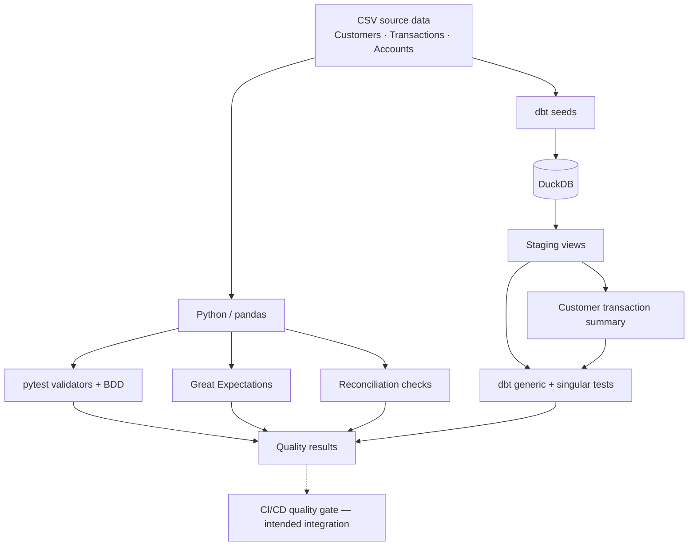

<div align="center">

# Data Quality Automation Framework

**A modular, locally reproducible framework for validating data ingestion, transformations, business rules, and reconciliation.**

Python · pytest · pytest-bdd · Great Expectations · dbt · DuckDB

    

</div>

---

## Overview

This project demonstrates a layered approach to data quality engineering for a small, synthetic banking dataset. It validates source data with Python and Great Expectations, loads and transforms records with dbt and DuckDB, checks warehouse-level constraints, and uses BDD to express selected business requirements.

**Key capabilities:** reusable Python validators; declarative and custom SQL tests; referential integrity checks; business-rule validation; source-to-target reconciliation; and a foundation for automated CI/CD quality gates.

> **Implementation scope:** This is a foundational assignment using deterministic local data, not a production banking deployment. The CI/CD architecture and production extensions below describe the intended approach; they should not be interpreted as evidence of a deployed production pipeline.

## Verified results

| Execution | Result | Evidence / scope |
|:--|:--:|:--|
| All dbt data tests | **22 passed** | `dbt test` |
| Custom dbt SQL tests | **3 passed** | `dbt test --select test_type:singular` |
| Accounts dbt build | **11 passed** | 1 seed + 1 view + 9 generic tests |
| BDD scenarios | **6 passed** | `python -m pytest tests/test_bdd.py -v` |
| Standalone account balance pytest | **1 passed** | `python -m pytest tests/test_account_balance.py -v` |
| Earlier full Python suite | **14 passed** | Before the accounts extension |

> **Verification note:** The full Python suite has not yet been rerun after the accounts extension. Run `python -m pytest -v` for an updated overall count. The targeted Python and BDD results above are verified independently; do not add them together as though they were disjoint suites.

## Contents

- [Architecture](#architecture)
- [Technology and responsibilities](#technology-and-responsibilities)
- [Repository structure](#repository-structure)
- [Datasets and quality rules](#datasets-and-quality-rules)
- [Getting started](#getting-started)
- [Running the tests](#running-the-tests)
- [Adding a new data quality rule](#adding-a-new-data-quality-rule)
- [Debugging and negative testing](#debugging-and-negative-testing)
- [Design decisions and future improvements](#design-decisions-and-future-improvements)

## Architecture



**Execution paths are complementary, not strictly sequential.** Python/BDD and Great Expectations validate source-level behaviour, while dbt evaluates loaded and transformed data. Reconciliation checks compare source and target metrics. dbt's `ref()` manages SQL model dependencies.

### dbt lineage

```text
customers.csv ── dbt seed ──> stg_customers ──────┐
                                                   ├──> customer_transaction_summary
transactions.csv ── dbt seed ──> stg_transactions ──┘

accounts.csv ── dbt seed ──> stg_accounts
                                  │
                                  └── customer_id references stg_customers.customer_id
```

## Technology and responsibilities

| Technology | Responsibility |
|:--|:--|
| **Python 3.12 / pandas** | Read datasets and implement reusable validation functions |
| **pytest** | Execute Python assertions, data quality checks, and reconciliation tests |
| **pytest-bdd** | Map Given–When–Then business scenarios to reusable Python validators |
| **Great Expectations 1.3.8** | Declarative expectations for customer and transaction datasets |
| **dbt 1.9.3** | Load seeds, build SQL models, run generic and singular tests |
| **dbt-duckdb 1.9.2 / DuckDB** | Lightweight local analytical database |
| **GitHub Actions** | Intended automated execution and merge-blocking quality gate |

Locally verified versions also include Python **3.12.10**, pytest **8.3.5**, and pytest-bdd **8.1.0**.

## Repository structure

```text
data-quality-automation-framework/
├── .github/
│   └── workflows/                       # CI/CD workflow configuration
├── dbt_project/
│   ├── models/
│   │   ├── staging/
│   │   │   ├── schema.yml                # Generic column / relationship tests
│   │   │   ├── stg_customers.sql
│   │   │   ├── stg_transactions.sql
│   │   │   └── stg_accounts.sql
│   │   └── marts/
│   │       └── customer_transaction_summary.sql
│   ├── seeds/
│   │   ├── customers.csv
│   │   ├── transactions.csv
│   │   └── accounts.csv
│   ├── tests/                            # Singular dbt SQL tests
│   │   ├── assert_non_negative_account_balance.sql
│   │   ├── no_future_transactions.sql
│   │   └── no_non_positive_completed_transactions.sql
│   ├── dbt_project.yml
│   └── profiles.yml
├── features/
│   ├── data_quality.feature
│   └── account_balance.feature
├── src/
│   ├── data_loader.py
│   ├── gx_validation.py
│   ├── reconciliation.py
│   └── validators.py
├── tests/                                # Python / pytest / BDD tests
│   ├── conftest.py
│   ├── test_account_balance.py
│   ├── test_bdd.py
│   ├── test_data_quality.py
│   ├── test_great_expectations.py
│   └── test_reconciliation.py
├── warehouse/
├── pytest.ini
├── requirements.txt
├── .env.example
└── README.md
```

> There are **two different `tests/` directories**: `dbt_project/tests/` contains singular SQL tests; root `tests/` contains Python and BDD tests.

## Datasets and quality rules

The repository uses synthetic data to make failures easy to reproduce and diagnose.

| Dataset | Representative fields | Validation examples |
|:--|:--|:--|
| **Customers** | `customer_id`, `email`, `country_code` | Required/unique IDs, non-null email, accepted country codes (`GB`, `IE`) |
| **Transactions** | `transaction_id`, `customer_id`, `currency`, `status`, `amount` | Required/unique IDs, valid customer reference, allowed currency/status, no future dates, positive amount when completed |
| **Accounts** | `account_id`, `customer_id`, `account_type`, `balance`, `status` | Required/unique account ID, valid customer reference, accepted types/statuses, non-null and non-negative balance |

The accounts seed contains four sample accounts linked to customer IDs `1001`, `1002`, and `1003`. A customer can have multiple accounts; an account ID must remain unique.

### Validation layers

| Layer | Where rules live | Examples |
|:--|:--|:--|
| **Source-level Python** | `src/validators.py`, root `tests/` | Null counts, duplicate counts, orphan keys, negative balances |
| **Business-readable BDD** | `features/`, `tests/test_bdd.py` | Account balances must be non-negative |
| **Dataset expectations** | `src/gx_validation.py` | Required fields, unique identifiers, accepted values |
| **Warehouse generic tests** | `dbt_project/models/staging/schema.yml` | `not_null`, `unique`, `accepted_values`, `relationships` |
| **Warehouse singular tests** | `dbt_project/tests/*.sql` | Non-negative balance, no future transactions, positive completed amounts |
| **Reconciliation** | `src/reconciliation.py` | Row-count and amount-total comparisons |

## Getting started

Run the following from the **repository root** using Windows PowerShell.

### 1. Create and activate the environment

```powershell
py -3.12 -m venv .venv
.\.venv\Scripts\Activate.ps1
python -m pip install --upgrade pip
pip install -r requirements.txt
```

### 2. Validate the Python environment

```powershell
python --version
python -m pytest --version
python -c "import great_expectations as gx; print(gx.__version__)"
```

### 3. Load and validate warehouse data

```powershell
cd dbt_project
dbt debug
dbt seed
dbt run
dbt test
```

Or use the combined dependency-aware command:

```powershell
dbt build
```

`dbt seed` loads CSVs; `dbt run` builds SQL models; `dbt test` executes registered data tests; `dbt build` executes selected resources in dependency order. A failed upstream step should stop a scripted pipeline rather than allowing downstream commands to run on stale data.

## Running the tests

### Python tests — from repository root

```powershell
# All Python tests
python -m pytest -v

# Individual suites
python -m pytest tests/test_account_balance.py -v
python -m pytest tests/test_bdd.py -v
python -m pytest tests/test_great_expectations.py -v
python -m pytest tests/test_reconciliation.py -v
```

### dbt tests — from `dbt_project/`

```powershell
# All registered data tests
dbt test

# Only custom SQL tests
dbt test --select test_type:singular

# Only account-model tests
dbt test --select stg_accounts

# Reload the accounts seed, rebuild its view and run selected generic tests
dbt build --select +stg_accounts

# Inspect registered test names
dbt ls --resource-type test
```

**Current dbt inventory:** 3 seeds, 4 models and **22 data tests** (19 generic and 3 singular). The full `dbt test` execution passed **22/22**; all three singular SQL tests also passed when selected independently.

### Understanding PASS, FAIL, and ERROR

| Outcome | Meaning | Example |
|:--|:--|:--|
| **PASS** | The validation executed and found no violations | All balances are non-negative |
| **FAIL** | The validation executed and found invalid rows | A completed transaction has a non-positive amount |
| **ERROR** | The test could not execute correctly | Missing relation or incompatible data types |

For a **singular dbt SQL test**, **zero returned rows means PASS**; returned rows are treated as rule violations.

## Adding a new data quality rule

The accounts extension demonstrates how to onboard a dataset and implement the same rule at different layers.

### A. Add a custom dbt SQL test

Create `dbt_project/tests/assert_non_negative_account_balance.sql`:

```sql
SELECT
    account_id,
    balance
FROM {{ ref('stg_accounts') }}
WHERE balance < 0
```

Execute from `dbt_project/`:

```powershell
dbt test --select assert_non_negative_account_balance
```

`ref('stg_accounts')` resolves the existing model and registers the dependency. The query returns **only invalid accounts**.

The other two singular tests in the project check that transaction dates are not in the future and that completed transactions have positive amounts.

### B. Add a reusable Python validator

In `src/validators.py`:

```python
def negative_balance_count(df):
    return (df["balance"] < 0).sum()
```

In `tests/test_account_balance.py`:

```python
import pandas as pd
from src.validators import negative_balance_count


def test_account_balances_are_non_negative():
    df = pd.read_csv("dbt_project/seeds/accounts.csv")
    result = negative_balance_count(df)
    assert result == 0, f"Found {result} accounts with negative balances"
```

Verified: **1 passed**.

### C. Reuse the existing BDD step definitions

`features/account_balance.feature`:

```gherkin
Feature: Account balance validation

  Scenario: Accounts must not have negative balances
    Given the accounts dataset is available
    When I validate account balances
    Then all account balances should be non-negative
```

The corresponding Given/When/Then definitions are added to the **existing** `tests/test_bdd.py`, which discovers feature files via `scenarios(FEATURES)`. An `accounts` fixture loads the seed CSV; the When step calls `negative_balance_count(accounts)` and uses `target_fixture="result"`; the Then step asserts `result == 0`.

Verified: **6 BDD scenarios passed** (including the new account scenario).

### D. Extend generic dbt tests

In `dbt_project/models/staging/schema.yml`, the `stg_accounts` model declares nine generic tests covering account ID, customer ID, account type, balance, and status. For example:

```yaml
- name: stg_accounts
  columns:
    - name: account_id
      data_tests:
        - not_null
        - unique
    - name: customer_id
      data_tests:
        - not_null
        - relationships:
            to: ref('stg_customers')
            field: customer_id
```

This is an **excerpt** from the existing `models:` list, not a complete replacement for `schema.yml`.

## Debugging and negative testing

The framework was tested against controlled invalid inputs as well as valid data.

| Scenario | Observed behaviour | Lesson |
|:--|:--|:--|
| Missing customer reference | Relationship test failed | Referential integrity is checked after ingestion |
| Duplicate transaction ID | `unique` test failed | Schema-valid data can still violate uniqueness |
| Alphanumeric value in numeric seed column | Seed conversion error | Type compatibility matters before transformation |
| New account IDs like `C001` vs numeric customer IDs | DuckDB relationship test ERROR | Align join-key types and actual values |
| `stg_accounts` tests before building the view | Missing-relation ERROR | Build dependencies before testing |
| New tests absent from selection | Full dbt reparse resolved registration | Check manifest/discovery before changing valid YAML |

**Accounts extension troubleshooting:** the initial accounts seed referenced customer IDs `C001`–`C003`, whereas the existing customers seed used numeric IDs `1001`–`1005`. Updating the new seed to use valid existing customer IDs and rebuilding resolved the type mismatch. The accounts build then completed with **11/11 successful operations**.

### Avoid stale warehouse state

```text
dbt seed
   ├── PASS → dbt run → dbt test
   └── FAIL → STOP
```

If a load fails but later commands continue, they may query relations left from an earlier successful run. Use a fail-fast CI/CD job or `dbt build` where appropriate.

## Design decisions and future improvements

### Why these tools?

- **DuckDB** keeps the exercise self-contained while supporting realistic SQL transformations.
- **dbt** places schema, relationships, and SQL business rules close to warehouse models.
- **pytest** makes custom Python checks, assertions, and reusable fixtures straightforward.
- **pytest-bdd** expresses selected business requirements in language stakeholders can review.
- **Great Expectations** provides another declarative validation mechanism for source datasets.
- **Reconciliation** checks row counts and totals that isolated column-level tests might miss.

The intent is **layered coverage, not duplicating every rule in every tool**. The account balance rule is intentionally implemented across tools as a demonstration.

### CI/CD quality gate

A target workflow is: checkout → Python setup → dependency installation → Python tests + dbt build → publish results → block promotion on failure. A non-zero test exit code should fail the job. Actual CI behaviour should be confirmed against the workflow file before claiming it is deployed.

### Production extensions

| Area | Proposed enhancement |
|:--|:--|
| **Scalability** | Warehouse-side aggregation, incremental and partition-aware tests |
| **Data contracts** | Schema drift detection and versioned data contracts |
| **Observability** | Null-rate trends, freshness, reconciliation variance, failure history |
| **Failure handling** | Quarantine invalid records and severity-based quality gates |
| **Operations** | Notifications, test reports, historical results, secure secrets management |
| **Security** | Avoid exposing customer data in logs, test artifacts, or local extracts |

The sample data is synthetic. A production banking implementation should keep validation close to governed data platforms, minimise unnecessary movement of sensitive records, and use approved credentials and access controls.

---

<div align="center">

**Project status:** dbt **22/22 passed** · BDD **6/6 passed** · account pytest **1/1 passed**  
*Full post-extension Python suite: rerun required for an updated total.*

</div>
